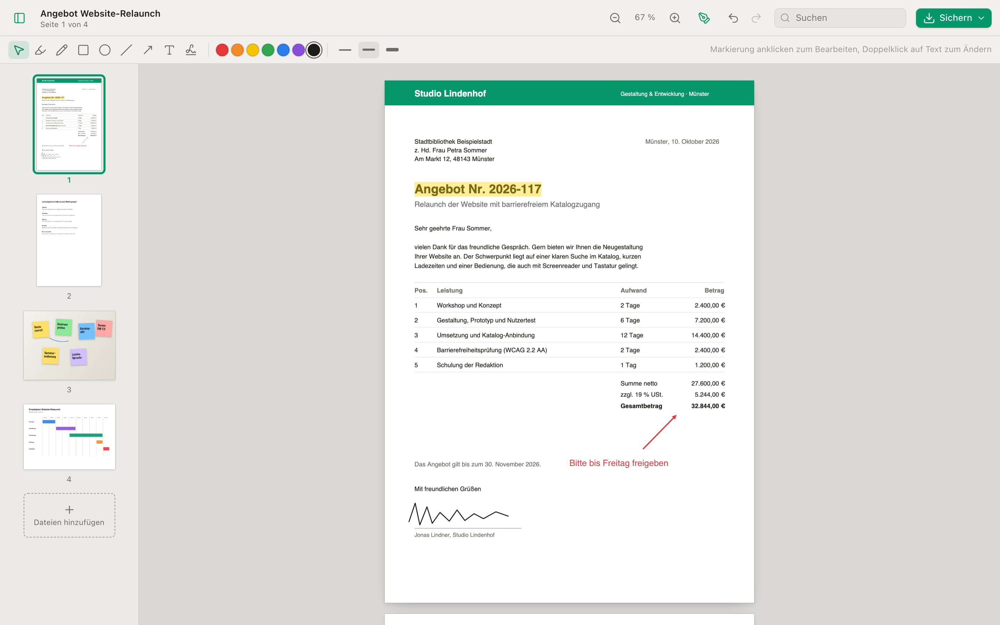
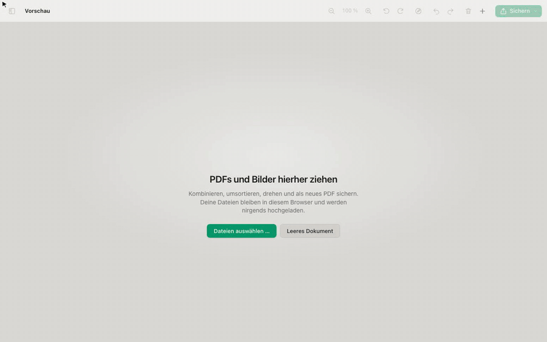
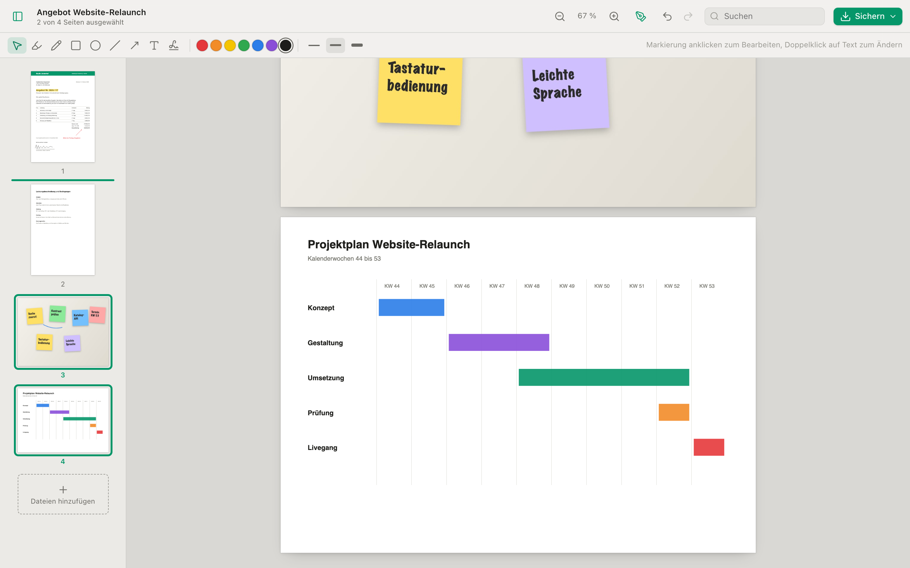
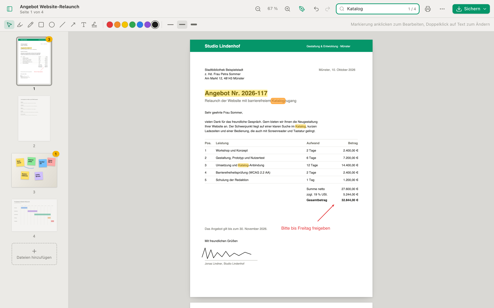
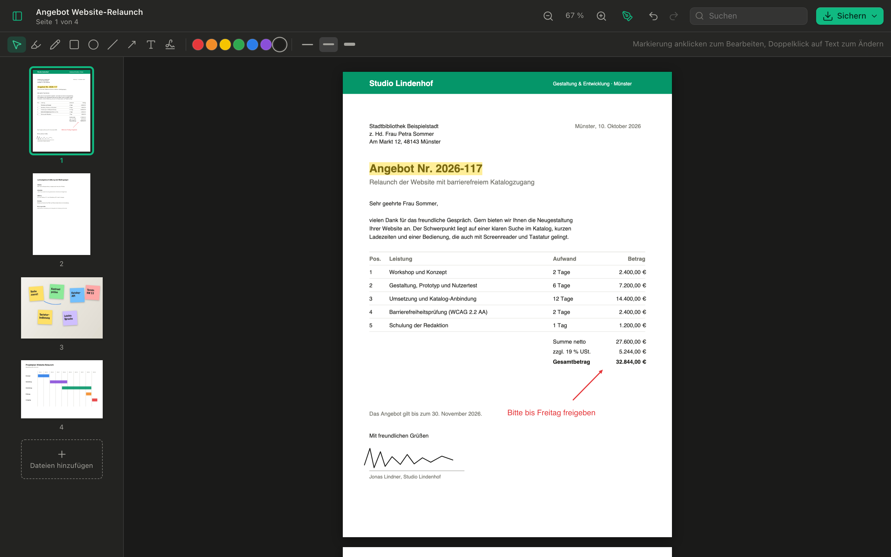
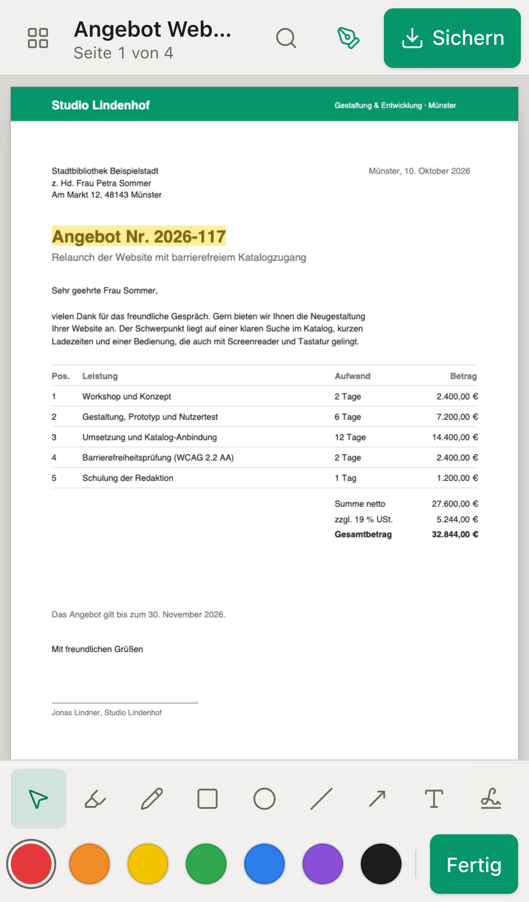
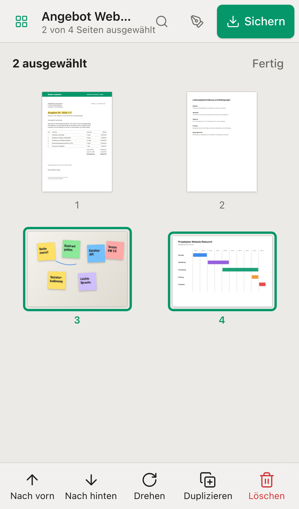

# Vorschau

**PDFs kombinieren, Seiten sortieren und markieren – direkt im Browser, ohne Upload.**

Eine Web-App nach dem Vorbild der macOS-App Vorschau. Dateien werden ausschließlich auf deinem Gerät verarbeitet, es gibt keine Konten, kein Tracking und keinen Server, der Dokumente sieht.

**[Im Browser öffnen](https://rasalas.github.io/pdf-preview/)** · [Desktop-Apps herunterladen](https://github.com/Rasalas/pdf-preview/releases/latest) · [Demo-Video (MP4)](docs/media/demo.mp4)



## Was die App kann

- **Zusammenstellen:** PDFs und Bilder (JPEG, PNG, TIFF, HEIC, WebP, GIF, BMP, AVIF, SVG) hineinziehen, gezielt zwischen zwei Seiten einfügen, Seiten per Drag & Drop umsortieren, drehen, duplizieren, löschen und leere Seiten einfügen. Neben einer Miniatur erscheinen Drehen, „Mehr“ und Löschen, zwischen zwei Miniaturen ein „+“ zum Einfügen, am Ende der Liste die Kachel „Dateien hinzufügen“.
- **Beschneiden:** Seiten auf einen Ausschnitt zuschneiden, etwa den Tisch um ein fotografiertes Dokument oder breite Scanränder. „Beschneiden …“ im Seitenmenü oder ⌘K, Rahmen ziehen, mit ↩ übernehmen. Mit mehreren ausgewählten Seiten gilt derselbe Ausschnitt für alle; Widerrufen und Zurücksetzen gehen jederzeit.
- **Bilder:** Mehrseitige TIFF-Scans (Fax- und Scanner-Kompression) werden zu einer Seite je Blatt, die Auflösung bestimmt die Seitengröße, ein 300-dpi-Scan wird also A4. iPhone-Fotos (HEIC) öffnen auch in Chrome und Firefox. Die Drehung aus den Fotodaten (EXIF) gilt in der Vorschau und im gesicherten PDF gleich, JPEGs bleiben dabei unverändert.
- **Markieren:** Text hervorheben, frei zeichnen, Rechtecke, Ovale, Linien, Pfeile, Textfelder und die eigene Unterschrift. Alles lässt sich verschieben, skalieren und umfärben.
- **Lesen:** Text auswählen und kopieren, im ganzen Dokument suchen, Treffer pro Seite in der Seitenleiste. Passwortgeschützte PDFs öffnen nach Eingabe des Passworts.
- **Texterkennung:** Scans und Fotos ohne Textebene lesbar machen, auf Deutsch und Englisch, ganz auf dem Gerät. Am Computer beginnt sie nach dem Öffnen von selbst mit den Seiten ohne Text, im Hintergrund und jederzeit abzubrechen. Auf dem Smartphone startet sie erst auf Wunsch, um Daten und Akku zu schonen: „Text erkennen …“ steht im Seitenmenü, im Menü „Mehr“ und als Hinweis in der Suche. Erkannter Text lässt sich auswählen, kopieren, hervorheben und durchsuchen und steht unsichtbar im gesicherten PDF, das so auch in anderen Programmen durchsuchbar ist.
- **Ausfüllen:** Formulare direkt in der App ausfüllen: Textfelder (auch mehrzeilig und als Kästchenreihe), Ankreuzfelder, Optionen, Auswahllisten. Ein Feld, das auf mehreren Seiten vorkommt, zeigt überall denselben Wert. Eingaben überstehen ein Neuladen und stehen beim Sichern und Drucken im PDF.
- **Sichern:** als neues PDF oder nur die ausgewählten Seiten, außerdem Drucken. Originalseiten bleiben unverändert erhalten, Text bleibt durchsuchbar. „Kleiner sichern“ rechnet Fotos und Scans auf etwa 150 dpi herunter und komprimiert sie neu, damit das PDF durch Upload-Formulare und Mailserver passt; Text, Schriften und Vektorgrafiken bleiben unangetastet. Enthält ein PDF Scans im Format JBIG2, das manche Programme und Portale ablehnen, schreibt „Ohne JBIG2 sichern“ sie Bildpunkt für Bildpunkt in ein Format um, das jedes Programm liest. Wurde der Scan mit Mustererkennung komprimiert, weist die App vorher darauf hin, dass dabei schon beim Scannen Zeichen vertauscht worden sein können.
- **Sicher arbeiten:** Widerrufen für jeden Schritt, und nach einem versehentlichen Neuladen lässt sich das Dokument wiederherstellen.



| Seiten umsortieren | Suchen | Dunkles Erscheinungsbild |
| --- | --- | --- |
|  |  |  |

Auf dem Smartphone ordnet die App Werkzeuge in Reichweite des Daumens an: Seitenaktionen unten, Markieren als eigener Modus, die Seitenübersicht als Raster mit Auswahlmodus.

<p>
  
  
</p>

## Desktop-Apps

Für macOS, Windows und Linux gibt es installierbare Apps unter [Releases](https://github.com/Rasalas/pdf-preview/releases/latest). Sie funktionieren offline, öffnen PDFs per Doppelklick oder „Öffnen mit“, sichern über den Systemdialog und drucken über den PDF-Viewer des Systems.

Die Apps sind noch nicht signiert. Unter macOS beim ersten Start in *Systemeinstellungen → Datenschutz & Sicherheit* „Dennoch öffnen“ wählen, unter Windows bei SmartScreen „Weitere Informationen → Trotzdem ausführen“.

## Datenschutz

Öffnen, Bearbeiten und Sichern passieren vollständig im Browser; Dateien werden nirgends hochgeladen. Das zuletzt bearbeitete Dokument samt erkanntem Text und gezeichnete Unterschriften liegen nur lokal im Browser (IndexedDB bzw. `localStorage`) und lassen sich dort jederzeit verwerfen. Auch die Texterkennung läuft auf dem Gerät: Programm und Sprachdaten (rund 7 MB, erst geladen, wenn die App zum ersten Mal einen Scan liest) kommen von derselben Adresse wie die App, nicht von Dritten, und liegen in den Desktop-Apps gleich bei. Passwörter für geschützte PDFs werden nur zum Entschlüsseln im Browser verwendet und nicht gespeichert; das Dokument selbst liegt danach wie jedes andere unverschlüsselt in der lokalen Sitzung. Beim Aufruf der Seite verarbeitet allein der jeweilige Hoster technisch notwendige Daten; die App nennt ihn unter „Über und Datenschutz“.

## Tastenkürzel

| Kürzel | Aktion |
| --- | --- |
| ⌘O | Dateien einfügen |
| ⌘S | Als PDF sichern |
| ⌘P | Drucken |
| ⌘F | Suchen |
| ⌘G / ⇧⌘G, ↩ / ⇧↩ | Nächster / vorheriger Treffer |
| ⌘Z / ⇧⌘Z | Widerrufen / Wiederholen |
| ⌘R / ⌘L | Nach rechts / links drehen |
| ⌘D | Duplizieren |
| ⌘K | Seite beschneiden (↩ übernimmt, Esc bricht ab) |
| ⌫ | Auswahl löschen (Seiten oder Markierung) |
| ⌘A | Alle Seiten auswählen |
| ↑ ↓, ⇧↑ ⇧↓ | Seite wählen, Auswahl erweitern (in der Seitenleiste) |
| ⌥↑ ⌥↓ | Auswahl verschieben (in der Seitenleiste) |
| ⇥ / ⇧⇥, ↩ | Nächstes / vorheriges Formularfeld (↩ in Textfeldern: nächstes Feld) |
| ⌘+ / ⌘− / ⌘0 | Zoom |
| ⌥⌘S | Seitenleiste ein-/ausblenden |
| ⇧⌘A | Markierungsleiste ein-/ausblenden |
| Esc | Markierung abwählen, Formularfeld verlassen, Beschneiden abbrechen |

Unter Windows und Linux gilt Strg statt ⌘.

## Browser

Aktuelle Versionen von Chrome, Edge, Firefox und Safari (macOS und iPadOS). Getestet mit Chromium und WebKit, Letzteres auch mit nachgestellt fehlenden neuen APIs, wie sie in älteren Safari-Versionen fehlen. In Safari öffnet „Drucken“ das PDF in einem neuen Tab.

## Bekannte Grenzen

- Geschützte PDFs werden beim Import entschlüsselt (RC4 40/128 Bit, AES-128, AES-256). Mit Öffnen-Passwort fragt die App danach; PDFs, die nur Einschränkungen wie „Drucken verboten“ tragen, öffnen ohne Abfrage. Die Einschränkungen gelten in der App nicht, und gesicherte Kopien sind weder passwortgeschützt noch eingeschränkt. Mit Zertifikat oder DRM geschützte PDFs lassen sich nicht öffnen.
- Die Suche findet keine Begriffe, die in der PDF auf zwei Textstücke verteilt sind (bei erkanntem Text: auf zwei Zeilen); Scans ohne Textebene sind erst nach der Texterkennung durchsuchbar.
- Texterkennung: Gelesen wird gedruckter Text in Deutsch und Englisch, keine Handschrift. Die Seite wird so gelesen, wie sie angezeigt wird; seitlich eingescannte Seiten also vorher aufrichten, sonst bleibt die Seite ohne Text. Eine A4-Seite braucht wenige Sekunden. Saubere Scans und Fotos werden nahezu fehlerfrei gelesen, bei Schatten, Unschärfe und schrägem Winkel fehlen einzelne Umlaute und Wörter.
- Erkannter Text gehört zur Seite des Originals, Kopien einer Seite teilen ihn. Er lässt sich nicht bearbeiten und nicht mit „Widerrufen“ zurücknehmen. Beim Sichern fehlt erkannter Text außerhalb des Beschnitts, und Zeichen außerhalb des westeuropäischen Zeichensatzes werden durch „?“ ersetzt.
- Markierungen werden beim Sichern fest in den Seiteninhalt geschrieben und sind danach in anderen Programmen nicht mehr einzeln bearbeitbar.
- Animierte GIF- und WebP-Dateien zeigen nur das erste Bild. Bilder, die erst umgewandelt werden müssen (alles außer JPEG und PNG), werden ab etwa 16 Megapixeln verkleinert; BigTIFF und TIFF mit seltener Kompression werden abgelehnt.
- Textfelder und Formulareingaben nutzen Helvetica; Zeichen außerhalb des westeuropäischen Zeichensatzes werden beim Sichern durch „?“ ersetzt.
- Formulare: Unterstützt sind PDF-Formulare nach AcroForm. XFA-Formulare, JavaScript in PDFs (Berechnungen, Prüfungen) und Signaturfelder fehlen. Gefüllt wird nur, solange kein Markierungswerkzeug aktiv ist. Beim Sichern und Drucken werden die Eingaben fest in die Seiten geschrieben, das Formular lässt sich danach nicht mehr ausfüllen. Kennwortfelder bleiben leer. „Widerrufen“ der App nimmt Eingaben nicht zurück (im Feld gilt das Widerrufen des Browsers), und die Suche findet sie nicht.
- Beschneiden blendet nur aus: Die gesicherte Datei behält Inhalt und Text außerhalb des Ausschnitts, und andere Programme können den Rand wieder aufdecken. Wer etwas unlesbar machen muss, kann es so nicht schwärzen. In der App findet die Suche auch Text außerhalb des Ausschnitts (der Treffer ist dann nicht zu sehen), und beim Ziehen über mehrere Zeilen landet verdeckter Text zwischen Anfang und Ende in der Auswahl. „Kleiner sichern“ rechnet Bilder nach der ganzen Seite, nicht nach dem Ausschnitt, damit der sichtbare Teil nicht unschärfer wird.
- „Kleiner sichern“ fasst nur Bilder an (JPEG sowie Flate in RGB oder Grau) und ersetzt sie nur, wenn das Ergebnis spürbar kleiner ist. Bilder in CMYK, Indexed, JBIG2, CCITT oder JPEG 2000 und Bilder mit Farbschlüsselmaske bleiben unverändert. Das Ergebnis hängt vom Browser ab, weil jeder JPEGs anders schreibt; Safari vor 16.4 rechnet nur JPEG-Bilder neu.

## Entwicklung

```sh
npm install
npm run dev     # Entwicklungsserver
npm test        # Tests
npm run build   # statische Seite in dist/
npm run media   # Screenshots und Demo-Video in docs/media neu erzeugen
npm run tauri dev     # Desktop-App im Entwicklungsmodus (braucht Rust)
npm run tauri build   # Desktop-App für das aktuelle System bauen
```

`npm run media` baut die App, spielt mit erfundenen Beispieldokumenten einen festen Ablauf in Chromium durch und legt Screenshots, `demo.mp4` und `demo.gif` ab (Video nur mit installiertem `ffmpeg`; `-- --no-video` überspringt es). Dasselbe läuft per Knopfdruck auf GitHub unter *Actions → Bilder und Video → Run workflow* und öffnet einen Pull Request mit den neuen Bildern.

## Veröffentlichung

Die Quelle ist dieses Repository auf GitHub. Jeder Push auf `main` veröffentlicht die App auf [GitHub Pages](https://rasalas.github.io/pdf-preview/). Ein Tag wie `v0.1.0` baut die Desktop-Apps für alle drei Systeme und legt sie als Entwurf unter Releases ab.

Auf [git.nrw](https://git.nrw) liegt ein Spiegel, der Änderungen von hier übernimmt und die App per GitLab Pages veröffentlicht (`.gitlab-ci.yml`). Einrichtung dort:

1. Neues Projekt anlegen, am besten in einer Gruppe mit weiteren Maintainern, damit Spiegel und Seite unabhängig von einzelnen Konten weiterlaufen.
2. *Settings → Repository → Mirroring repositories*: `https://github.com/Rasalas/pdf-preview.git`, Richtung *Pull*, „Trigger pipelines for mirror updates“ aktivieren.
3. Nach der ersten Pipeline steht die Adresse unter *Deploy → Pages*.

Die Builds unterscheiden sich nur in den Angaben zu Hoster, Datenschutz und Impressum (Umgebungsvariablen `VITE_HOST_NAME`, `VITE_PRIVACY_URL`, `VITE_IMPRINT_URL`) und darin, ob Unterstützungslinks erscheinen (`VITE_FUNDING`).

## Lizenz

[MIT](LICENSE) © Torben Buck. Verwendet [pdf.js](https://mozilla.github.io/pdf.js/) (Apache 2.0), [pdf-lib](https://pdf-lib.js.org/) (MIT), [UTIF.js](https://github.com/photopea/UTIF.js) (MIT) und, nur zum Entsperren geschützter PDFs, [qpdf](https://qpdf.sourceforge.io/) (Apache 2.0) als WebAssembly über [@neslinesli93/qpdf-wasm](https://github.com/neslinesli93/qpdf-wasm) (ISC). Für HEIC-Fotos in Browsern ohne eigene Unterstützung dient [libheif](https://github.com/strukturag/libheif) mit libde265 (LGPL-3.0, verpackt in [libheif-js](https://github.com/catdad-experiments/libheif-js)). Es liegt unverändert als eigene Datei im Ordner `heif/` der App, wird nur bei Bedarf geladen und lässt sich dort durch eine andere Version ersetzen; der Lizenztext liegt daneben. Für die Texterkennung dient [tesseract.js](https://github.com/naptha/tesseract.js) (Apache 2.0) mit [Tesseract](https://github.com/tesseract-ocr/tesseract) (Apache 2.0) als WebAssembly über tesseract.js-core, das auch Leptonica (BSD) sowie libpng, libjpeg, libtiff, giflib und zlib (alle freizügig lizenziert) enthält, dazu die Sprachdaten [tessdata_fast](https://github.com/tesseract-ocr/tessdata_fast) (Apache 2.0). Engine und Sprachdaten liegen unverändert im Ordner `ocr/` der App, die Lizenztexte daneben.
